# Processus industriels complets et chaînes de production

## 1. Objectif du document

Ce document décrit les 20 grands processus industriels qui structurent une économie de production réaliste et crédible. Il vise à donner une vue complète des transformations physiques, chimiques et thermiques qui permettent de passer des matières premières aux matériaux, produits intermédiaires et biens finis.

Le document ne se limite pas à une liste de recettes : il décrit, pour chaque grand processus,
- la logique de transformation ;
- les sous-processus constitutifs ;
- les flux de matières et d’énergie ;
- les machines ou équipements typiques ;
- les produits principaux et les sous-produits ;
- le diagramme de chaîne associé.

L’objectif est d’aider à la conception du mod Factorio `Realistic Production` en gardant une progression industrielle cohérente, crédible et jouable.

---

## 2. Vue d’ensemble des 20 grands process

| # | Grand process | Sous-processus clés | Produits principaux |
|---|---|---|---|
| 1 | Sidérurgie intégrée | extraction, réduction, conversion, laminage | acier, tôles, poutres |
| 2 | Four à arc électrique | tri, fusion, affinage, coulée | acier recyclé |
| 3 | Calcination et clinkérisation | concassage, cuisson, refroidissement, mouture | ciment |
| 4 | Verre float | fusion, flottage, recuit, découpe | verre plat |
| 5 | Bayer + Hall-Héroult | bauxite, digestion, calcination, électrolyse | alumine, aluminium |
| 6 | Distillation atmosphérique | dessalage, vaporisation, fractionnement | naphta, kérosène, gazole |
| 7 | Vapocraquage | mélange vapeur, chauffage, craquage, trempe | éthylène, propylène |
| 8 | Polymérisation | purification, réaction, extrusion | polyéthylène, polypropylène |
| 9 | Reformage du méthane | désulfuration, reformage, conversion, purification | hydrogène |
| 10 | Distillation cryogénique de l’air | compression, filtration, liquéfaction, rectification | O₂, N₂, Ar |
| 11 | Électrolyse de l’eau | filtration, électrolyse, compression | H₂, O₂ |
| 12 | Haber-Bosch | compression, synthèse, condensation | ammoniac |
| 13 | Production de l’urée | compression, réaction, granulation | urée |
| 14 | Procédé Solvay | ammoniation, carbonatation, filtration, calcination | carbonate de sodium |
| 15 | Osmose inverse | filtration, pressurisation, membrane, reminéralisation | eau douce |
| 16 | Réduction directe du fer | préparation, réduction, consolidation | fer réduit |
| 17 | Fabrication de la chaux | calcination, extinction, stockage | chaux vive |
| 18 | Extraction et raffinage de l’huile végétale | nettoyage, pressage, raffinage | huile végétale |
| 19 | Biométhanisation | prétraitement, fermentation, purification | biogaz / méthane |
| 20 | Fabrication du papier | défibrage, pulpage, séchage | papier / carton |

---

## 3. Logique de construction d’un grand process

Tout grand process industriel suit en général cette logique :

1. Approvisionnement de la matière première ;
2. Préparation mécanique (broyage, écrasement, séparation, lavage) ;
3. Conversion ou séparation principale ;
4. Purification ou raffinage ;
5. Mise en forme, stockage, conditionnement ou expédition.

Les sous-processus sont souvent associés à des équipements distincts : foreuses, broyeurs, fours, réacteurs, colonnes de distillation, filtres, électrolyseurs, compresseurs, centrifugeuses, sécheurs, tour de lavage, etc.

---

## 4. Détail complet des 20 grands processes

### 1. Sidérurgie intégrée : production de l’acier

#### Sous-processus
- extraction et concassage du minerai de fer ;
- préparation et enrichissement du concentré ;
- réduction dans un haut fourneau ;
- conversion de la fonte en acier ;
- laminage ou coulée du métal.

#### Équipements typiques
- foreuse minière ;
- concasseur primaire ;
- broyeurs à boulets ;
- mélangeur de charge ;
- haut fourneau ;
- convertisseur ;
- lingotière / coulée continue ;
- laminoir.

#### Diagramme
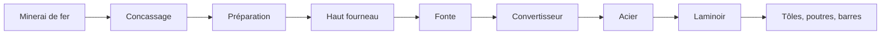

#### Description
Le minerai de fer est extrait, concassé puis préparé pour augmenter sa qualité et faciliter la réduction. Il est ensuite introduit dans un haut fourneau avec du coke, des fondants et un courant d’air chaud. La réduction transforme le minerai en fonte liquide. La fonte est ensuite convertie en acier pour éliminer l’excès de carbone et ajuster la composition. L’acier liquide est enfin coulé et transformé en produits finis ou semi-finis, comme barres, bobines, tôles et profilés.

#### Produits / sous-produits
Produits : acier, barres, tôles, poutres, tubes. Sous-produits : laitier, gaz de haut fourneau, poussières.

---

### 2. Four à arc électrique : acier recyclé

#### Sous-processus
- tri des ferrailles ;
- préparation et chargement du four ;
- fusion par arc électrique ;
- affinage du métal ;
- coulée et mise en forme.

#### Équipements typiques
- atelier de tri ;
- déchiqueteur / concasseur ;
- four à arc électrique ;
- lance d’oxygène ;
- installation d’affinage ;
- machine de coulée continue.

#### Diagramme
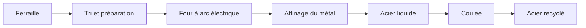

#### Description
Le four à arc électrique transforme les ferrailles et métaux recyclés en acier de qualité contrôlée. Les déchets sont d’abord triés, broyés et chargés dans le four. Un arc électrique intense chauffe le métal jusqu’à fusion. Ensuite, le métal est ajusté pour corriger la composition chimique avant d’être coulé. Ce procédé est particulièrement important dans les chaînes de recyclage, car il réduit la consommation de matière première vierge et la dépendance aux minerais.

#### Produits / sous-produits
Produits : acier recyclé, billettes, slabs. Sous-produits : scories, poussières, gaz de fusion.

---

### 3. Calcination et clinkérisation : production du ciment

#### Sous-processus
- broyage du calcaire et de l’argile ;
- homogénéisation du mélange ;
- préchauffage ;
- calcination ;
- refroidissement et mouture finale.

#### Équipements typiques
- concasseur ;
- broyeur à cru ;
- mélangeur ;
- tour de préchauffage ;
- four rotatif ;
- refroidisseur de clinker ;
- broyeur à boulets.

#### Diagramme
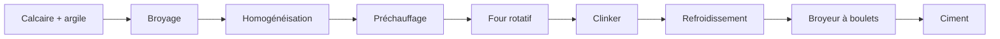

#### Description
Le calcaire et l’argile sont broyés et mélangés sous forme de farine. Le mélange entre ensuite dans un préchauffeur puis dans un four rotatif, où la température dépasse 1200 °C puis approche 1450 °C. La décarbonatation du calcaire et la fusion partielle des silicates conduisent à la formation du clinker. Après refroidissement, la matière est broyée avec du gypse pour réguler la prise. Le produit final est le ciment, qui servira ensuite à fabriquer le béton.

#### Produits / sous-produits
Produits : ciment, béton. Sous-produits : CO₂, poussières, chaleur résiduelle.

---

### 4. Verre float : fabrication du verre plat

#### Sous-processus
- préparation du mélange de silice ;
- fusion du mélange ;
- flottage sur bain d’étain ;
- recuit ;
- découpe et finition.

#### Équipements typiques
- silos de matière première ;
- mélangeur ;
- four à fusion ;
- cuve de flottage ;
- tunnel de recuit ;
- machine de découpe.

#### Diagramme

#### Description
Le verre est fabriqué à partir d’un mélange de silice, de carbonate de sodium et de calcaire. Ce mélange est fondu à très haute température jusqu’à obtenir un verre liquide homogène. Le verre liquide est ensuite déversé sur un bain d’étain liquide. Comme il est moins dense que l’étain, il flotte à la surface et s’étale de manière régulière. Cela donne une plaque de verre plane et uniforme, très adaptée au vitrage. Le verre est ensuite recuit pour éliminer les tensions internes et découpé selon les dimensions utiles.

#### Produits / sous-produits
Produits : verre float, vitrages, fenêtres, panneaux. Sous-produits : chutes de verre, poussières.

---

### 5. Bayer + Hall-Héroult : production de l’aluminium

#### Sous-processus
- extraction et concassage de la bauxite ;
- digestion et clarification ;
- calcination pour produire l’alumine ;
- électrolyse dans un bain de cryolithe ;
- coulée et mise en forme.

#### Équipements typiques
- exploitation de bauxite ;
- broyeur ;
- digesteur Bayer ;
- clarificateur ;
- fours de calcination ;
- cuve d’électrolyse ;
- fonderie de coulée.

#### Diagramme

#### Description
La bauxite est traitée par procédé Bayer pour produire de l’alumine. La bauxite est mélangée à de la soude et chauffée sous pression pour dissoudre l’aluminium. Les impuretés restent solides et sont séparées. L’alumine est ensuite calcinée puis dissoute dans une cryolithe fondue. Dans la cuve d’électrolyse, un courant électrique très intense sépare l’aluminium de l’oxygène. L’aluminium liquide se dépose au fond de la cuve, est soutiré puis coulé en lingots, profilés ou feuilles.

#### Produits / sous-produits
Produits : alumine, aluminium primaire, profilés. Sous-produits : boues rouges, CO₂, déchets d’anode.

---

### 6. Distillation atmosphérique : fractionnement du pétrole brut

#### Sous-processus
- dessalage et décantation ;
- préchauffage ;
- vaporisation ;
- fractionnement en tour de distillation ;
- récupération des coupes.

#### Équipements typiques
- décanteur ;
- échangeurs de chaleur ;
- four de préchauffage ;
- tour de distillation ;
- colonnes de récupération ;
- réservoirs de stockage.

#### Diagramme
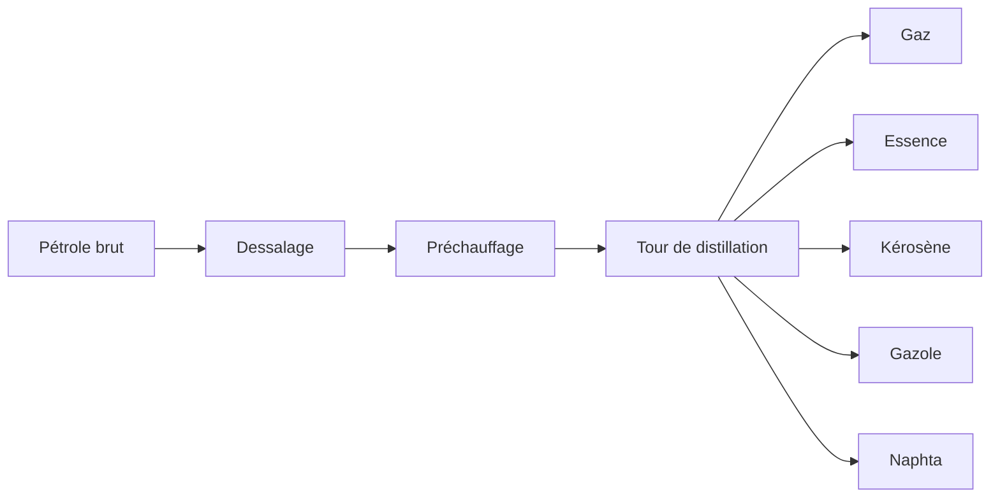

#### Description
Le pétrole brut est un mélange très complexe d’hydrocarbures. Il est d’abord dessalé pour éliminer les sels dissous, puis chauffé et vaporisé dans un four. Le mélange liquide-vapeur est injecté dans une tour de distillation qui est plus chaude en bas et plus froide en haut. Les fractions les plus légères montent et sont condensées plus haut ; les plus lourdes restent plus bas. Cette séparation permet de récupérer les différents produits intermédiaires tels que les gaz, l’essence, le kérosène, le gazole et le naphta.

#### Produits / sous-produits
Produits : essence, kérosène, gazole, naphta. Sous-produits : résidus lourds, bitume, gaz de tête.

---

### 7. Vapocraquage : production des monomères

#### Sous-processus
- mélange du naphta avec de la vapeur ;
- préchauffage ;
- craquage thermique ;
- trempe rapide ;
- distillation et séparation des monomères.

#### Équipements typiques
- mélangeur ;
- four de craquage ;
- réacteur tubulaire ;
- système de trempe ;
- colonnes de fractionnement.

#### Diagramme
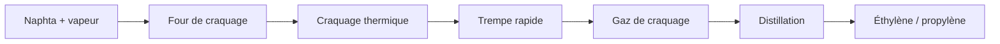

#### Description
Le vapocraquage transforme de longues molécules hydrocarbonées en molécules plus courtes et plus réactives, comme l’éthylène et le propylène. Le naphta est mélangé à de la vapeur d’eau puis chauffé très fortement dans un four de craquage. Sous l’effet du choc thermique, les longues chaînes moléculaires se cassent. Les gaz sont ensuite refroidis rapidement pour stopper les réactions et les séparer par distillation. Les monomères ainsi obtenus alimentent ensuite les grandes chaînes de polymérisation.

#### Produits / sous-produits
Produits : éthylène, propylène, butadiène. Sous-produits : méthane, hydrogène, coke.

---

### 8. Polymérisation : fabrication des plastiques

#### Sous-processus
- purification du monomère ;
- alimentation du réacteur ;
- réaction de polymérisation ;
- séparation du polymère ;
- extrusion / granulation.

#### Équipements typiques
- réacteur de polymérisation ;
- compresseur ;
- boucle de recirculation ;
- extrudeuse ;
- granulateur ;
- système de refroidissement.

#### Diagramme

#### Description
La polymérisation consiste à relier plusieurs molécules de monomère pour former des chaînes longues appelées polymères. Selon le monomère choisi, on produit du polyéthylène, du polypropylène, du PVC ou d’autres matériaux. Le monomère est introduit dans un réacteur sous température et pression contrôlées, parfois avec un catalyseur. La réaction génère des particules fines ou un polymère fondu qui est ensuite filtré, refroidi et transformé en granulés. Ces granulés sont ensuite utilisés pour le moulage, la fabrication, l’extrusion ou la mise en film.

#### Produits / sous-produits
Produits : polyéthylène, polypropylène, PVC. Sous-produits : monomères résiduels, eau, déchets de traitement.

---

### 9. Reformage du méthane : production d’hydrogène

#### Sous-processus
- désulfuration du gaz naturel ;
- mélange avec de la vapeur ;
- reformage primaire ;
- conversion du CO ;
- purification PSA.

#### Équipements typiques
- unité de désulfuration ;
- mélangeur de gaz ;
- réacteur de reformage ;
- échangeurs thermiques ;
- colonne de conversion ;
- unité PSA.

#### Diagramme
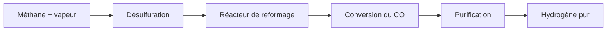

#### Description
Le méthane est d’abord débarrassé de ses composés soufrés afin de protéger les catalyseurs. Ensuite, le gaz est mélangé à de la vapeur surchauffée et introduit dans un réacteur où une réaction endothermique produit du monoxyde de carbone et de l’hydrogène. Le mélange est ensuite traité dans une étape de conversion supplémentaire afin d’augmenter encore la quantité d’hydrogène. Enfin, le mélange est purifié par adsorption à variation de pression pour éliminer le CO₂ et le méthane résiduel. Le produit final est de l’hydrogène très pur, utilisé dans la chimie, l’industrie pétrochimique et les usages énergétiques.

#### Produits / sous-produits
Produits : hydrogène pur, gaz de synthèse. Sous-produits : CO₂, vapeur, condensats.

---

### 10. Distillation cryogénique de l’air : séparation des gaz industriels

#### Sous-processus
- compression de l’air ;
- filtration et épuration ;
- refroidissement cryogénique ;
- liquéfaction partielle ;
- rectification en colonne de distillation.

#### Équipements typiques
- compresseur multi-étages ;
- filtres et adsorbeurs ;
- échangeur cryogénique ;
- turbine de détente ;
- double colonne de distillation.

#### Diagramme
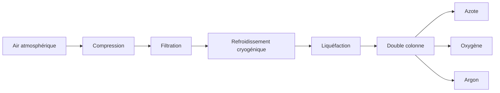

#### Description
L’air est comprimé puis filtré pour retirer l’humidité et le dioxyde de carbone. Il est ensuite refroidi à des températures extrêmement basses afin d’être liquéfié. L’air liquide est injecté dans une double colonne de distillation. L’azote, plus volatil, s’évapore en premier et remonte. L’oxygène, plus lourd, reste plus bas. L’argon est séparé entre les deux. Ce procédé fournit des gaz très purs, utilisés pour la métallurgie, la combustion, la cryogénie et la production chimique.

#### Produits / sous-produits
Produits : oxygène, azote, argon. Sous-produits : traces de krypton et xénon, purge gazeuse.

---

### 11. Électrolyse de l’eau : production d’hydrogène vert

#### Sous-processus
- prétraitement de l’eau ;
- alimentation du système d’électrolyse ;
- séparation des ions ;
- récupération des gaz ;
- compression et stockage.

#### Équipements typiques
- pompe et filtration ;
- électrolyseur ;
- membrane de séparation ;
- séparateur de gaz ;
- compresseur d’hydrogène.

#### Diagramme
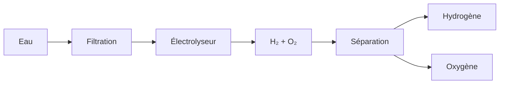

#### Description
L’électrolyse de l’eau consiste à décomposer la molécule d’eau par passage d’un courant électrique. À la cathode, le dihydrogène est produit ; à l’anode, du dioxygène est libéré. Si l’électricité vient de sources renouvelables, l’hydrogène produit est qualifié de « vert ». Ce procédé est particulièrement important dans les scénarios de transition énergétique, car il permet de produire un vecteur énergétique sans combustion directe de fossiles.

#### Produits / sous-produits
Produits : hydrogène, oxygène. Sous-produits : chaleur résiduelle, eau de purge.

---

### 12. Haber-Bosch : synthèse de l’ammoniac

#### Sous-processus
- purification de l’azote et de l’hydrogène ;
- compression du mélange ;
- réaction catalytique ;
- condensation ;
- recyclage des gaz non convertis.

#### Équipements typiques
- unité de séparation de l’air ;
- réacteur de reformage ;
- compresseur haute pression ;
- réacteur Haber-Bosch ;
- condenseur ;
- recycleur de gaz.

#### Diagramme
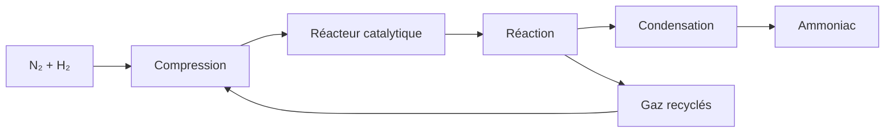

#### Description
L’ammoniac est synthétisé à partir d’azote et d’hydrogène dans un réacteur catalytique à haute pression et température modérée à élevée. Les gaz sont comprimés et passés sur un catalyseur de fer. Une part de l’azote et de l’hydrogène est convertie en ammoniac. Après réaction, le mélange est refroidi pour faire condenser l’ammoniac, tandis que les gaz non convertis sont recyclés. Ce procédé est fondamental pour l’agriculture intensive et la production des engrais.

#### Produits / sous-produits
Produits : ammoniac liquide ou gazeux. Sous-produits : H₂ et N₂ recyclés.

---

### 13. Production de l’urée : synthèse d’engrais azoté

#### Sous-processus
- compression de l’ammoniac ;
- réaction avec du CO₂ ;
- formation de carbamate ;
- décomposition et séparation ;
- granulation et séchage.

#### Équipements typiques
- compresseur NH₃ ;
- réacteur de synthèse ;
- séparateur de vapeur ;
- cristalliseur / granulateur ;
- séchoir.

#### Diagramme

#### Description
L’urée est produite par réaction de l’ammoniac avec le dioxyde de carbone sous pression. Dans un premier temps, on forme du carbamate, qui est ensuite décomposé pour donner de l’urée et de la vapeur. La solution est ensuite concentrée et granulee pour créer un engrais stable et facilement stockable. L’urée est très utilisée dans l’agriculture parce qu’elle contient une forte proportion d’azote et qu’elle se transporte et s’applique facilement.

#### Produits / sous-produits
Produits : urée, granulés d’engrais. Sous-produits : vapeur, traces de gaz.

---

### 14. Procédé Solvay : carbonate de sodium

#### Sous-processus
- préparation de la saumure ;
- ammoniation ;
- carbonatation ;
- précipitation du bicarbonate ;
- filtration et calcination.

#### Équipements typiques
- réservoir de saumure ;
- tour d’absorption ;
- tour de carbonatation ;
- filtre rotatif ;
- calcinateur rotatif.

#### Diagramme
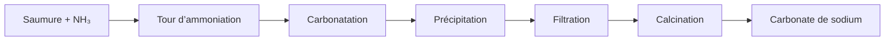

#### Description
Le procédé Solvay part de la saumure, c’est-à-dire d’une solution saline concentrée. Cette saumure est saturée en ammoniac puis mise en contact avec du CO₂ dans une tour de carbonatation. La réaction produit du bicarbonate de sodium, qui précipite grâce à son faible degré de solubilité. Les cristaux sont filtrés puis calcinés pour former du carbonate de sodium. Ce matériau est utilisé dans le verre, la verrerie, les détergents et la production chimique.

#### Produits / sous-produits
Produits : carbonate de sodium, bicarbonate. Sous-produits : chlorure d’ammonium, sels résiduels.

---

### 15. Dessalement par osmose inverse : production d’eau douce

#### Sous-processus
- prétraitement de l’eau ;
- mise sous pression ;
- séparation dans la membrane ;
- collecte des flux ;
- reminéralisation.

#### Équipements typiques
- filtration grossière ;
- ultra-filtration ;
- pompes haute pression ;
- modules membranaires ;
- système de reminéralisation.

#### Diagramme
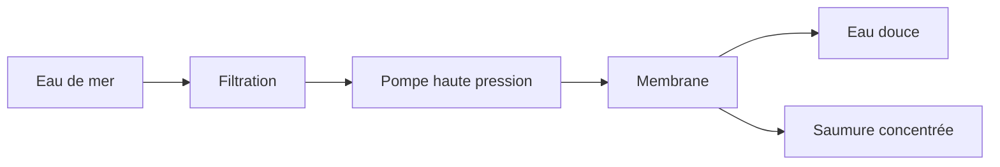

#### Description
Le dessalement par osmose inverse sépare l’eau des sels dissous en la poussant à travers une membrane semi-perméable. L’eau de mer est d’abord filtrée pour éliminer les particules et organismes. Ensuite, des pompes lui donnent une pression importante, supérieure à la pression osmotique naturelle. La membrane laisse passer l’eau pure, tandis que les ions dissous restent en concentration plus élevée. La saumure concentrée est rejetée et l’eau douce est collectée pour être reminéralisée et distribuée.

#### Produits / sous-produits
Produits : eau douce, eau de process. Sous-produits : saumure concentrée, boues de filtration.

---

### 16. Réduction directe du fer : fabrication de fer sans haut fourneau

#### Sous-processus
- préparation du minerai ;
- mélange avec des agents réducteurs ;
- réduction à température contrôlée ;
- séparation des fines ;
- consolidation du métal.

#### Équipements typiques
- broyeur et mélangeur ;
- réacteur de réduction ;
- gaz réducteur ;
- séparateur de fines ;
- four de consolidation.

#### Diagramme
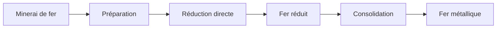

#### Description
La réduction directe du fer est une voie alternative à la sidérurgie classique. Le minerai est préparé puis exposé à un gaz réducteur, souvent à base d’hydrogène ou de monoxyde de carbone, à température inférieure à celle du haut fourneau. Cela permet d’obtenir un fer spongieux ou réduit. Le produit final peut être utilisé directement ou être transformé plus tard dans un four de finition. Cette technique est parfois considérée comme plus propre et plus modulable, car elle réduit la dépendance au coke et la consommation de charbon.

#### Produits / sous-produits
Produits : fer réduit, fer spongieux. Sous-produits : poussières, gaz résiduels.

---

### 17. Fabrication de la chaux : transformation du calcaire

#### Sous-processus
- extraction du calcaire ;
- concassage ;
- calcination ;
- refroidissement ;
- éventuelle extinction à l’eau.

#### Équipements typiques
- carrière ;
- concasseur ;
- four de calcination ;
- refroidisseur ;
- silo de stockage.

#### Diagramme
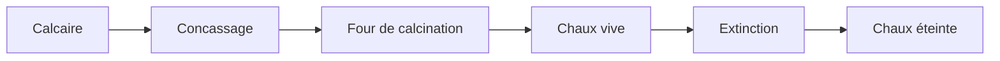

#### Description
Le calcaire est chauffé à haute température pour le faire décarbonater. La roche perd son dioxyde de carbone et laisse place à l’oxyde de calcium, appelé chaux vive. Cette chaux peut ensuite être mise en contact avec de l’eau pour former de la chaux éteinte. La chaux est utilisée dans le bâtiment, dans les liants, dans la métallurgie et dans certains traitements chimiques. Elle est donc un matériau industriel essentiel, bien que rarement vue comme un produit final de forte valeur, mais plutôt comme un intermédiaire clé.

#### Produits / sous-produits
Produits : chaux vive, chaux éteinte. Sous-produits : CO₂, poussières.

---

### 18. Extraction et raffinage de l’huile végétale

#### Sous-processus
- nettoyage des graines ;
- concassage et pressage ;
- extraction du liquide lipidique ;
- clarification ;
- raffinage final.

#### Équipements typiques
- trieur et nettoyeur ;
- broyeurs ;
- presses à huile ;
- extracteur ;
- décanteur ;
- unité de raffinage.

#### Diagramme
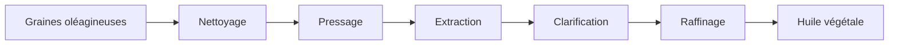

#### Description
Les graines oléagineuses sont d’abord nettoyées pour éliminer les impuretés et les résidus de terre. Elles sont ensuite concassées et comprimées pour extraire l’huile. L’huile brute contient encore des phospholipides, des pigments et des impuretés qu’il faut éliminer. Les étapes de clarification et de raffinage réduisent ces composés afin d’obtenir une huile propre, stable et utilisable dans l’alimentation, l’industrie ou les biocarburants. Les résidus solides, appelés tourteaux, peuvent être valorisés au niveau agricole ou animal.

#### Produits / sous-produits
Produits : huile brute, huile raffinée. Sous-produits : tourteaux, boues, poussières.

---

### 19. Biométhanisation : production de méthane à partir de matière organique

#### Sous-processus
- collecte et mélange de la biomasse ;
- homogénéisation ;
- digestion anaérobie ;
- purification du biogaz ;
- valorisation du digestat.

#### Équipements typiques
- silo de stockage ;
- broyeurs et mélangeurs ;
- digesteur anaérobie ;
- agitateur ;
- purification du biogaz ;
- compresseur / stockage.

#### Diagramme
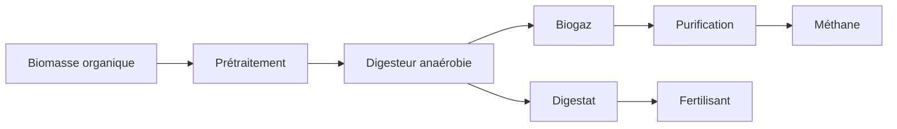

#### Description
La biométhanisation transforme des matières organiques en biogaz par fermentation anaérobie. La biomasse est d’abord prétraitée pour homogénéiser les composants et améliorer la réaction. Elle est ensuite introduite dans un digesteur, où des bactéries dégradent la matière sans oxygène. Le biogaz produit est alors purifié pour séparer le méthane des impurities, principalement le CO₂. Le résultat peut être utilisé comme combustible ou gaz de synthèse. Le résidu solide ou liquide, le digestat, constitue souvent un fertilisant de valeur pour l’agriculture.

#### Produits / sous-produits
Produits : méthane, biogaz, digestat. Sous-produits : CO₂, matière organique stabilisée.

---

### 20. Fabrication du papier et du carton

#### Sous-processus
- réception du bois ou des fibres ;
- défibrage et pulpage ;
- blanchiment / coloration ;
- couchage et séchage ;
- découpe et conditionnement.

#### Équipements typiques
- broyeur de bois ;
- pulpeur ;
- chaudière de cuisson ;
- machine de papier ;
- séchoir ;
- calandre ;
- découpeuse.

#### Diagramme

#### Description
Le papier est fabriqué à partir de fibres végétales, généralement du bois ou de fibres recyclées. Les fibres sont d’abord défibrées puis mélangées avec de l’eau pour former une pâte. Cette pâte est ensuite raffinée, souvent blanchie ou colorée, puis déposée sur une machine à papier. L’eau est extraite de la suspension, puis le produit est séché et fini pour obtenir un support solide. Le papier peut être utilisé pour l’impression, l’emballage, la communication ou l’usage industriel. Le carton est produit selon une logique similaire, mais avec des couches et des grammages plus importants.

#### Produits / sous-produits
Produits : papier, carton, emballages. Sous-produits : eaux de procédé, boues, résidus de fibre.

---

## 5. Chaînes industrielles cohérentes pour le jeu

Les 20 grands processes forment des chaînes qui s’enchaînent naturellement :

- minerai de fer → réduction → acier ;
- calcaire + argile → clinker → ciment ;
- bauxite → alumine → aluminium ;
- pétrole brut → naphta → éthylène → plastique ;
- air → oxygène / azote ;
- méthane + vapeur → hydrogène → ammoniac → urée ;
- biomasse → méthane → énergie ;
- bois → pâte → papier ;
- eau de mer → eau douce ;
- ferrailles → acier recyclé.

Cette logique de dépendance permet d’obtenir une économie industrielle crédible et progressive. Les sous-produits ne sont pas juste des déchets : ils peuvent alimenter d’autres chaînes, rendre les installations plus réalistes et donner une qualité de jeu plus complète.

---

## 6. Conclusion

Un mod industriel crédible doit refléter le réel : les matières premières sont d’abord exploitées, puis préparées, transformées, séparées, raffinées et enfin mises en forme. Les grands processes décrits ici représentent les briques fondamentales de cette logique industrielle.

Le document peut servir de base de conception pour :
- la progression technologique ;
- l’architecture des machines ;
- les dépendances entre ressources et produits ;
- la création de chaînes de production ;
- l’équilibrage de l’économie du jeu.

En intégrant les sous-processus, les machines correspondantes et les diagrammes de flux, on obtient un cadre de développement cohérent et exploitable pour une production Factorio complète, crédible et intéressante.